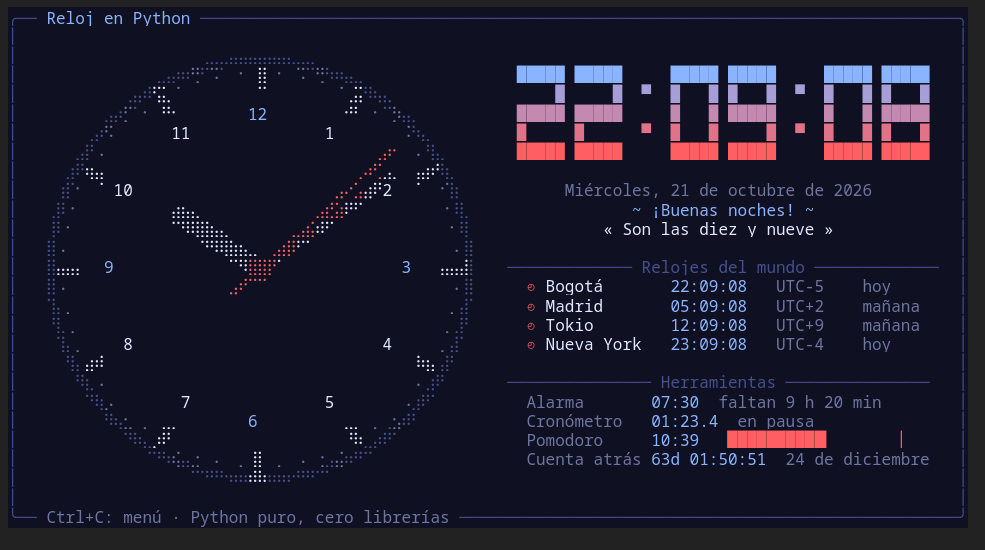

# 🕰️ Reloj en Python

Reloj analógico y digital que se dibuja **en la terminal**, hecho solo con Python puro:
sin librerías (ni siquiera la librería estándar), sin HTML y sin CSS. Los únicos `import`
son entre los módulos del propio proyecto.



## Uso

```bash
python3 main.py
```

El reloj se actualiza 10 veces por segundo. Con **Ctrl+C** se abre el menú:

| Opción | Qué hace |
|---|---|
| 1 | Cambiar el tema: Medianoche, Clásico, Neón, Matrix o Atardecer |
| 2 | Programar o quitar la alarma (`HH:MM`) |
| 3 | Cronómetro: iniciar o pausar |
| 4 | Cronómetro: reiniciar |
| 5 | Pomodoro de 25 minutos: iniciar o cancelar |
| 6 | Cambiar la fecha de la cuenta atrás (`DD/MM`) |
| 7 | Reloj al revés |
| 8 | ¡Girar el reloj! |
| 9 | Modo arcoíris |
| 0 | Salir |

Con Enter se vuelve al reloj. Cuando suena la alarma, Ctrl+C la apaga.

## Requisitos

- Python 3.10 o superior
- Linux (lee `/proc` y `/usr/share/zoneinfo`)
- Una terminal con colores de 24 bits, de al menos **100 × 27** caracteres
  (Warp, GNOME Terminal, Ptyxis, Kitty, Konsole…)

## Funcionalidades

- 🕰️ **Reloj analógico** dibujado con puntos braille (cada carácter tiene 2 × 4 puntos), con
  un segundero que avanza a saltos como uno real.
- 🔢 **Reloj digital** con dígitos grandes en bloques y degradado de color.
- 📅 **Fecha en español**, un **saludo** según la hora y la **hora en palabras**
  ("Son las diez y cuarto").
- 🌎 **Relojes del mundo**: Bogotá, Madrid, Tokio y Nueva York, con su horario de verano.
- ⏰ **Alarma** con campana de la terminal y aviso parpadeante.
- ⏱️ **Cronómetro** con pausa y décimas de segundo.
- 🍅 **Pomodoro** de 25 minutos con barra de progreso.
- ⏳ **Cuenta atrás** hasta una fecha especial (por defecto, Navidad).
- 🎉 **Modo divertido**: reloj al revés, giro animado de la esfera y modo arcoíris.
- 🎨 **5 temas de color**.

## ¿Cómo funciona sin librerías?

| Necesidad | Solución con Python puro |
|---|---|
| Hora actual | `/proc/stat` (momento del arranque) + `/proc/uptime`, leídos con `open()` |
| Zona horaria | Lector propio del formato binario TZif de `/etc/localtime` |
| Horario de verano | Intérprete propio de reglas POSIX (`CET-1CEST,M3.5.0,M10.5.0/3`) |
| Fecha | Algoritmo de días ↔ calendario civil |
| Seno y coseno | Series de Taylor escritas a mano |
| Dibujo | Caracteres braille, bloques y códigos de color ANSI de 24 bits |
| Animación | Se redibuja en el sitio con `\x1b[H` en la pantalla alterna de la terminal |
| Teclado | Ctrl+C llega como `KeyboardInterrupt` y abre el menú con `input()` |

## Limitaciones

- Sin `time.sleep()` la espera entre cuadros se hace revisando el reloj en un bucle, así que
  el programa usa un núcleo del procesador al 100 % mientras corre.
- Sin el módulo `termios` no se pueden leer teclas sueltas; por eso todo se controla desde el
  menú de Ctrl+C. Mientras el menú está abierto el dibujo se pausa, pero el tiempo del
  cronómetro, del pomodoro y de la alarma sigue contando.
- No se puede medir el tamaño de la terminal; si es más pequeña que 100 × 27 el dibujo se
  desordena.
- Si `/proc/stat` no está disponible se usa el reloj de hardware, que en algunos equipos
  guarda la hora local en vez de UTC.

## Arquitectura

```
main.py                     punto de entrada
reloj/
├── config.py               ajustes: tamaños, zonas del mundo, tiempos
├── app.py                  ClockApp: une las capas, bucle en vivo y menú
├── core/                   lógica pura, sin pantalla
│   ├── system_clock.py     SystemClock: hora desde /proc
│   ├── dates.py            calendario y LocalTime
│   ├── timezones.py        TimeZone y PosixRule (lector de TZif)
│   ├── trig.py             seno y coseno con series de Taylor
│   ├── spanish.py          nombres, formatos y la hora en palabras
│   └── parsing.py          validación de lo que escribe el usuario
├── features/               herramientas con estado
│   ├── alarm.py  stopwatch.py  pomodoro.py  countdown.py
│   ├── world.py            relojes del mundo
│   ├── effects.py          al revés, giro y arcoíris
│   └── toolbox.py          Toolbox: agrupa todas las herramientas
└── ui/                     todo lo que dibuja
    ├── colors.py  terminal.py  themes.py
    ├── canvas.py           lienzo braille
    ├── screen.py           cuadrícula de caracteres → cuadro ANSI
    ├── analog.py  big_digits.py  widgets.py
    ├── dashboard.py        Dashboard: compone la pantalla
    └── menu.py             menú de Ctrl+C y preguntas
tests/                      pruebas con asserts simples
```

Las dependencias van en un solo sentido: `core` ← `features` ← `ui` ← `app`.
`core` no sabe nada de la pantalla, las herramientas reciben el tiempo como parámetro
(no leen el reloj por su cuenta) y el `Dashboard` solo lee lo que recibe. Por eso cada
pieza se puede probar sola.

Para agregar una ciudad, cambiar el tamaño de la pantalla o la duración del pomodoro
basta con editar `reloj/config.py`.

## Pruebas

```bash
python3 -m tests
```

Tampoco usan librerías: `tests/__main__.py` es un ejecutor propio que corre cada función
`test_*` y termina con error si alguna falla.
